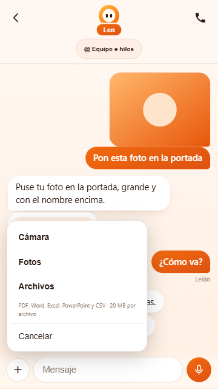
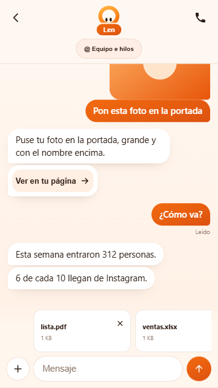

# Len Móvil: Cámara, Fotos y Archivos

28 de octubre de 2026. Implementado en feat/len-movil-2 del worktree propio.

El botón + del chat abre Cámara, Fotos y Archivos. La foto se previsualiza y puede quitarse. Los documentos muestran nombre/tamaño y se pueden quitar antes de enviar. Se admite una foto y hasta 4 documentos por mensaje: PDF, DOCX, XLSX, XLSM, PPTX y CSV, hasta 20 MB por documento, según el contrato existente de master.

## Capacidades existentes reutilizadas

La primera inspección se hizo sobre la base antigua de esta rama y llevó a una conclusión demasiado amplia sobre el servidor. Se revisó master e2a907f45 y se confirmó:

- lib/projects/chat-files.ts define AttachedFile, tipos y límites.
- lib/workspace-v2/upload-attachment.ts sube el fichero completo a POST /api/upload, con generationId del proyecto.
- /api/agent recibe attachedFiles, conserva las referencias y permite leer los bytes mediante las herramientas y skills.
- Las skills incluidas de PDF y Office ya leen/crean documentos; no se necesita otro parser móvil.

Se adaptó el cliente móvil a ese contrato. El módulo archivos.ts mantiene el DTO del cliente sin importar archivos todavía ausentes en esta rama antigua; no copia ni cambia las implementaciones del servidor. La integración de la rama con master la hará la otra sesión, como pidió el usuario. Los cambios exploratorios en dependencias se retiraron; no hay diferencias en package.json/package-lock.json.

## Comprobaciones

- 336 pruebas en 45 archivos pasan: suite móvil, rutas móviles y unidades FCM; se excluye **/*.pg.test.ts, que requiere PostgreSQL local.
- TypeScript raíz y móvil, ESLint del alcance y build Vite de producción correctos.
- reports/movil-adjuntos-check.cjs usa Edge con toque en 390x844 y 360x640. Bloquea toda red externa y utiliza clienteDeMuestra de DEV con archivos sintéticos. Comprueba cámara/fotos con filechooser simulado, entrada de documentos, selección múltiple, quitar, mensaje sin texto, archivo completo en FormData con proyecto/MIME, fallo/reintento sin subir dos veces el PDF, metadata de Excel, rechazo de ejecutable y espacio con teclado.
- La prueba del hook confirma que una subida antigua no envía al proyecto nuevo. El historial conserva los adjuntos y los reintentos mantienen sus bytes. Se liberan cachés al aparecer el mensaje guardado, borrar o cambiar de proyecto.
- AndroidManifest.xml válido; queries IMAGE_CAPTURE permite que Capacitor8 encuentre la cámara del sistema. capture=environment usa el FileChooser existente, sin añadir plugins ni acceso general a la biblioteca del teléfono.
- Revisión de código independiente sin defectos importantes.

## Pendiente real

No se ha integrado master ni se ha desplegado nada. El servidor basado únicamente en el commit antiguo de esta rama no incluye el soporte documental nuevo: el cliente se debe usar junto al servidor actual de master tras su integración/publicación. No se ha generado ni instalado la APK con este cambio.

La captura de cámara está comprobada en contrato/manifest y selección simulada, no en Android físico. Falta probar cámara real, proveedor de archivos del Samsung y lectura por las skills con el servidor integrado. Los tests no invocaron modelos ni enviaron archivos reales.
