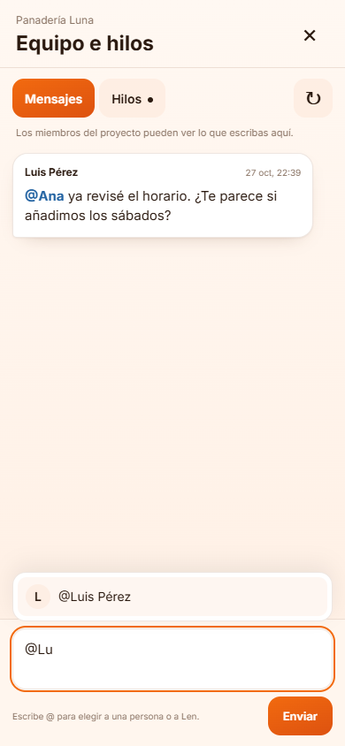
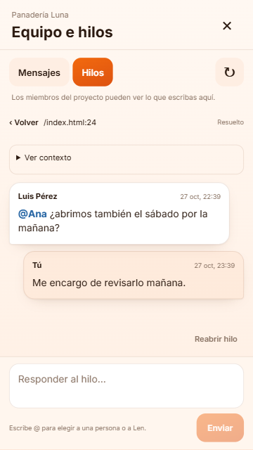
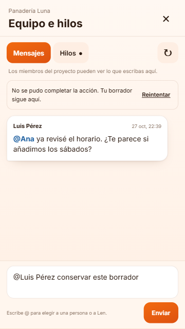

# Len Móvil — Equipo, menciones e hilos

Implementación local del 27 de octubre de 2026. Sin despliegue, instalación ni migraciones.

## Incluido

- Acceso «Equipo e hilos» desde la principal y el chat.
- Mensajes entre miembros con selector de @personas, autores y fechas. Son visibles para el proyecto.
- Lectura, respuestas y resolver/reabrir hilos existentes, con contexto de archivo/línea.
- @Len en hilos con los permisos de edición existentes; seguimiento de la fila en cola hasta terminar y actualización del proyecto.
- Menciones recibidas por notificación llevan al panel del equipo del proyecto autorizado.
- Diez idiomas; borradores por proyecto/hilo en memoria; errores sin perder el texto.
- Puente exclusivo `/api/movil/equipo` con llave Bearer, CORS y permisos existentes. Las rutas web de colaboración y sus servicios se reutilizan sin editar.

## Verificación

- 175 pruebas de alcance pasan: 174 en el lote de 13 archivos, más una prueba nueva del indicador de Len pendiente (el archivo final del panel pasa sus 5 pruebas).
- TypeScript de la raíz y del móvil sin errores.
- ESLint del alcance sin infracciones; el ejecutable sólo informa la deprecación de su formato de configuración existente.
- `npm run build` en `movil`: compilación Vite de producción correcta.
- `node reports/movil-equipo-check.cjs`: Edge con toque emulado en 390×844 y 360×640, sin errores JavaScript ni desbordamiento horizontal.
- Flujos: elegir @persona con toque, enviar, responder, resolver/reabrir, dos niveles de Atrás, cerrar desde hilo sin dejar capas, conservar borrador tras fallo y restricciones del lector.
- `git diff --name-only -- components/workspace-v2 app/api/projects lib/projects lib/workspace-v2`: sin cambios.

La revisión independiente encontró dos defectos y se corrigieron: consumo de las capas de navegación y seguimiento del trabajo de Len que aún está en cola. Las reproducciones fallaron antes de los arreglos y pasaron después.

## Capturas

## Pendiente para uso real

Publicar la nueva ruta del servidor y generar/instalar la APK con esta interfaz. La APK instalada anteriormente aún no incluye este cambio.

La QA usó datos de muestra sólo disponibles en DEV y servicios simulados en las pruebas. No se enviaron mensajes, correos, notificaciones ni pedidos reales a Len. Falta verificar entre dos cuentas reales y en Android físico, incluyendo teclado, avisos y su apertura. No se añadió editor de código para crear nuevos hilos por línea desde el celular; se portó la lectura y gestión de los existentes.
